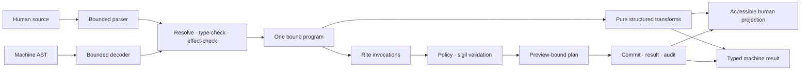

# Canticle command-language architecture

## Status

Canticle is a proposed language and shell architecture. Its surface syntax,
type details, and encoding are not accepted or stable. The requirements that
human and machine clients share authorization, that authority cannot be minted
by a client, and that material effects remain inspectable carry forward
regardless of the final syntax. The normal kernel currently has only a bounded
bootstrap interpreter. ADR 0020 separately accepts a removable fixed x86-64
shell-vessel fixture that projects one exact human source and one machine-direct
request onto equal low-level console rite semantics across restart. ADR 0021
separately accepts an allocation-free, unsafe-free host-only state-machine proof
of bounded semantic actions, private queueing, and exact session waiting. It is
not linked into the kernel, ABI, or shell-vessel fixture. Neither proof
implements a Canticle lexer, parser, AST, resolver, type/effect checker, session
runtime, machine encoding, or authenticated semantic path. No current component
implements the Canticle grammar, type system, machine form, or security
properties described here. This document is a design target and a basis for
incremental tests, not a production-security claim.

[ADR 0010](../adr/0010-canticle-secure-semantic-command-language.md) proposes
the language-level decision. Changes to its privilege boundary, stable syntax,
or machine encoding require an ADR.

## Purpose

Canticle is the command language for people and machines. It should be concise
enough to explore at a keyboard, regular enough for a machine to construct as a
tree, and explicit enough that a reviewer can see where authority and effects
enter a program.

The language is one client of the semantic control plane:



Parsing an expression, decoding an AST, or successfully type-checking either
one never grants authority. The semantic control plane remains the enforcement
boundary.

## Two command environments, deliberately separated

### Kernel bootstrap interpreter

The bring-up environment temporarily runs in ring 0 because Anomalous does not
yet have general circles, production IPC, or arbitrary vessel launch. Its
implementation-bound commands are
exactly:

```text
help
version
about
clear
echo
```

These commands are local and read-only with respect to system state; `clear`
changes only the current presentation. The interpreter has bounded input and no
variables, files, network, subprocesses, scripts, pipelines, dynamic
evaluation, sigils, or extensibility. Its structured events are identified as
`bootstrap_shell`, and `echo` arguments are not copied into structured serial
events.

This interface is not a small trusted Canticle runtime, a compatibility
profile, or a future stable API. Adding general parsing or privileged system
operations to it would enlarge the kernel attack surface and bypass the planned
semantic path. It should disappear from normal operation after the unprivileged
environment is viable, while a narrowly bounded recovery console may remain as
a separately specified mechanism.

### Canticle shell vessel

ADR 0020 proves only that a fixed ring-3 shell-shaped fixture can compose
task-bound rites, preemption, fault containment, destructive restart, and
terminal supervisor wake. Its `fixed_human_source` and `machine_direct` labels
describe test projections below this language; they do not define source
syntax, an AST, a machine encoding, a session model, or semantic authorization.

ADR 0021 separately models one host-only semantic route, a bounded private
FIFO, and an exact session wait/acknowledgement lifecycle. Its action vocabulary,
origins, identities, and capacities are removable proof scaffolding, not
Canticle syntax, a machine encoding, a session ABI, or authenticated input. A
trusted router outside the proof must stamp origin after enforcing route policy.
Paste may only insert text and a pasted line feed remains data; that constrains
paste-triggered submission inside this model only and does not establish focus,
secure attention, trusted paste, or a deployed router.

The real shell will be an unprivileged vessel inside a circle. It owns editing,
completion, parsing, type checking, session bindings, history policy, and value
projection. It discovers objects and rites through the same control plane as
the graphical shell and exec-hag. A shell crash must not become a kernel crash,
and the shell cannot mint sigils or override policy.

The shell's textual view is only one renderer. The same result can become an
accessible table, a graphical object, a serialized machine value, or a trace
entry without scraping terminal cells.

Evaluation returns its final value to the session host; local projection is not
an executable AST node. Sending that value across a principal or device
boundary, persisting it, or placing it on a clipboard is an explicit rite with
the applicable disclosure policy.

## Design constraints

- Human source and machine trees must resolve to the same bound program.
- Authority is explicit at every invocation and absent from pure evaluation.
- Structured data remains structured across a pipeline.
- Effects are discoverable without executing the program.
- Preview and commit are distinct for state-changing work.
- Secrets do not become ordinary text through convenience conversion.
- Source has no implicit reparsing step.
- Evaluation is bounded, cancellable, and attributable.
- Errors are typed values, not an invisible integer side channel.
- Syntax stays regular enough for a formatter and lossless editor tooling.
- Compatibility syntax cannot silently become native semantics.

These constraints deliberately favor clarity over reproducing every historical
shell shorthand.

## Source model

### Files and interactive input

The proposed versioned scripts begin with a language declaration and
conventionally use the `.cant` suffix:

```canticle
canticle 0.1
```

An interactive submission omits the declaration because its session already
selects a language version. Stored history records the selected version beside
the parsed tree. A session must never reinterpret old input under a newer
grammar without an explicit migration.

Source is valid UTF-8. Line endings are normalized for parsing. Identifiers are
ASCII and match `[a-z_][a-z0-9_]*`; qualified names join identifiers with a
period, such as `fs.list`. Keywords and identifiers are case-sensitive.
Project-defined names use `snake_case`.

Unicode text is valid inside strings. Bidirectional formatting characters and
non-printing control characters must be escaped inside a string and are rejected
elsewhere. A formatter exposes such escapes rather than rendering visually
ambiguous source. String payloads are not Unicode-normalized because exact data,
including foreign filenames, may depend on their scalar sequence.

`//` begins a line comment outside a string. Newlines terminate statements when
not nested in parentheses, brackets, or braces, except directly before or after
an infix operator that still requires an operand. A semicolon may terminate a
statement explicitly. Trailing commas are accepted in argument lists, lists,
and records.

### Strings and quoting

Double quotes are the only core string delimiter. The initial escape set is:

- `\\`, `\"`, `\n`, `\r`, and `\t`;
- `\0` for a zero byte only in a `b"..."` byte literal, not a text value; and
- `\u{hex}` for an explicit Unicode scalar value.

Strings have no `$name`, `${expression}`, backtick, or command-substitution
interpolation. They are never split on whitespace, expanded as globs, treated as
options, or parsed again. Composition uses ordinary typed functions:

```canticle
text.format(
    template: "{name} has {count} entries",
    values: {
        name: display_name,
        count: entry_count,
    },
)
```

The formatter consumes data; it cannot produce executable syntax. Code
generation builds AST nodes through a checked API rather than concatenating
source.

### Core literal and value types

The planned type vocabulary begins with:

| Family | Types and examples |
| --- | --- |
| Scalar | `unit`, `bool`, `i64`, `u64`, exact `decimal`, `text`, `bytes` |
| Domain | `path`, `uri`, `duration`, `byte_size`, `instant` |
| Structured | `list<T>`, records, versioned enums, `option<T>` |
| Control | `result<T, error>`, `stream<T, error>`, `plan<T>` |
| System | `object_ref<T>`, opaque `sigil_ref`, governed `secret<T>` |

Core literals include `()`, `true`, `false`, base-ten integers, quoted text,
`b"..."` bytes, lists, and records. Domain values use validating constructors
rather than string coercion:

```canticle
let root = path("./src")
let timeout = duration("250ms")
let budget = byte_size("8 MiB")
let options = {
    include_hidden: false,
    maximum_depth: 4,
}
```

Integer overflow, an invalid scalar escape, an invalid domain literal, a
duplicate record field, and a narrowing conversion are errors. Conditions
accept only `bool`; there are no truthy strings, numbers, lists, or objects.
Conversions such as `text.parse_i64` or `path.to_text` are explicit and
fallible where information or validation is involved.

An `object_ref<T>` identifies a semantic object and does not authorize access to
it. A `sigil_ref` is an opaque session binding: it is not printable,
serializable, orderable, or convertible to bytes. A `secret<T>` stays governed
through secret-aware transformations and renders as a disclosure label, never
its payload. Ordinary pure functions cannot unwrap or inspect it.
Declassification is an explicit rite with its own policy and audit event. This
labeling limits accidental disclosure; it does not claim to eliminate timing,
resource, or other covert channels.

## Minimum parser slice

The first host-tested parser can remain small while preserving the intended
shape. Its minimum grammar is:

```ebnf
program             = [ version ], { statement } ;
version             = "canticle", integer, ".", integer, terminator ;
statement           = let_statement | expression, terminator ;
let_statement       = "let", identifier, "=", expression ;
expression          = pipeline_expression, [ "?" ] ;
pipeline_expression = primary, { "|>", call_expression } ;
primary             = literal | named_expression | list | record
                    | invoke_expression
                    | preview_expression | commit_expression
                    | "(", expression, ")" ;
named_expression    = qualified_name, [ "(", [ arguments ], ")" ] ;
call_expression     = qualified_name, "(", [ arguments ], ")" ;
invoke_expression   = "invoke", rite_name, "(", [ arguments ], ")",
                      authority_clause ;
preview_expression  = "preview", rite_name, "(", [ arguments ], ")",
                      authority_clause ;
commit_expression   = "commit", "(", expression, ")", authority_clause ;
authority_clause    = "with", "[", [ identifiers ], "]" ;
arguments           = argument, { ",", argument }, [ "," ] ;
argument            = identifier, ":", expression ;
qualified_name      = identifier, { ".", identifier } ;
rite_name           = qualified_name ;
identifiers         = identifier, { ",", identifier }, [ "," ] ;
terminator          = newline | ";" ;
```

Lists and records recursively contain expressions. Duplicate named arguments
are rejected. Name resolution distinguishes a local field projection from a
qualified function or rite name; ambiguity is a compile-time error, never a
runtime search.

The minimum evaluator needs immutable `let` bindings, pure calls, structured
pipelines, explicit invocations, result propagation with `?`, and automatic
rendering of the final value. Functions, pattern matching, modules, imports, and
bounded concurrency can follow without changing the authority forms.

## A small read-only program

This program declares the authority name it expects, invokes a versioned
observation rite, propagates a structured error, and transforms records without
turning them into text:

```canticle
canticle 0.1

requires {
    workspace_read: [fs.list]
}

let entries = invoke fs.list(
    at: path("./src"),
    include_hidden: false,
) with [workspace_read]?

entries
    |> records.select(fields: ["name", "kind", "size"])
    |> records.sort(field: "name", order: sort_order.ascending)
```

`requires` is a static module declaration planned just beyond the minimum
parser. It states which named sigil bindings the program expects and the rites
to which it may present them. It does not request, acquire, broaden, or embed a
sigil. An interactive session exposes its available binding names and scopes
through a trusted inspector.

The relative `path` is resolved against a typed session location. Resolution
produces an object identity before policy evaluation; changing the session
location cannot retarget an already previewed plan.

## Effects and authority

### Effect classes

Rite schemas declare an effect set. The initial dimensions include observation,
mutation, execution, network, device control, secret access, authority
delegation, nondeterminism, and presentation. A rite may declare more than one.
Its schema also describes affected object classes, locality, resource estimates,
reversibility, cancellation, idempotency, and required sigil constraints.

Canticle uses three visibly different forms:

- ordinary calls are pure and cannot invoke a rite;
- `invoke` performs an observation or a policy-approved presentation effect;
  and
- `preview` constructs a plan for any mutation, execution, delegation, network
  transmission, or other material external effect; `commit` performs exactly
  that plan.

The type and effect checker rejects a material rite used with `invoke`. It also
rejects a pure-looking function whose declared effect summary is incomplete.
Time, randomness, environment lookup, and filesystem access are never implicit
sources of nondeterminism.

Every authority-bearing form includes `with`, including an explicit empty list:

```canticle
let release = invoke system.version() with []?
```

Bindings in that list are the maximum authority offered to the invocation, not
a claim that the operation needs or will receive all of it. The control plane
checks that each sigil is authentic, live, sufficiently narrow, valid for the
principal and target, and transferable across the boundary. Delegation cannot
be expressed by copying a binding; it is a separate rite.

### Preview and commit

A state-changing interaction has no direct convenience spelling:

```canticle
let proposed = preview fs.remove(
    target: path("./build/old.img"),
    recursive: false,
) with [workspace_write]?

proposed

let removal = commit(proposed) with [workspace_write]?
removal
```

The preview identifies resolved rite and object versions, effects, required
sigils, estimated cost, uncertainty, reversibility, cancellation behavior, and
an expiration or state precondition. Its digest covers the semantically bound
plan rather than display text.

Commit revalidates policy, sigils, plan digest, principal, target identities,
and freshness. A stale plan returns a structured error; it is not silently
re-previewed. Commit carries an idempotency identity so retry after transport
failure cannot unknowingly repeat the operation. Compensation is reported as a
separate possible rite and is never mislabeled as guaranteed rollback.

A trusted human surface may request confirmation according to policy. A machine
client receives the same plan and cannot set a syntax flag that suppresses that
gate.

## Structured pipelines

`value |> function(arguments)` passes `value` as the function's first input.
The bound AST records the resolved input slot, so changes to a function schema
cannot silently retarget it. Each stage receives one typed value or a typed
stream of values; there is no whitespace splitting or line protocol.

The initial pipeline operator accepts pure transformations only. An effectful
stage must be named in an `invoke`, `preview`, or `commit` expression and bound
to a variable. This makes reviews and effect summaries straightforward. A
future effect-aware streaming construct must preserve explicit authority,
backpressure, cancellation, item and byte budgets, ordering, and partial-result
semantics.

Pipelines do not have a hidden “last exit code.” A stage returns a value or a
`result`. Postfix `?` propagates an error from the current submission or
function. If an unhandled error terminates a streaming pipeline, the runtime
cancels upstream producers, waits for cancellation acknowledgement within a
budget, and reports producers that did not stop.

Collection is explicit because a stream may produce valid items before its
terminal error. Callers choose whether to process items incrementally, collect
only on complete success, or retain an explicitly labeled partial result.

## Errors

The common error schema includes:

- stable domain and code;
- safe human summary and machine-readable details;
- source span or AST node identity;
- rite, schema version, principal, trace, and invocation identity when present;
- retry classification and idempotency identity;
- partial-effect and compensation information;
- causal chain with a fixed depth and byte budget; and
- disclosure labels and redaction markers.

Errors are ordinary typed values under `result<T, error>`. Pattern matching will
allow explicit recovery; `?` is only transparent propagation. The interactive
renderer shows the safe summary, where the failure occurred, whether any effect
committed, and how to inspect permitted detail. It never prints secret-bearing
fields merely because debug output was requested.

Panics, vessel crashes, policy denials, cancellation, timeouts, stale previews,
and transport loss remain distinct outcomes. The shell must not translate them
all into a generic nonzero status.

## Foreign programs and text streams

There is no implicit lookup by a bare command name. Running a Linux, Windows,
macOS, or other foreign executable is an explicit rite on a compatibility veil.
Arguments are a list of values converted to the foreign ABI once, not a shell
string reparsed by another interpreter:

```canticle
let proposed = preview linux.process.run(
    executable: foreign_object,
    arguments: ["--fixed-strings", "--", needle],
    input: text.encode_utf8(source_text),
) with [linux_process, source_read]?

let process_result = commit(proposed) with [linux_process, source_read]?
```

Standard output bytes, standard error bytes, and termination state are separate
fields. Decoding bytes as lines or structured data is explicit and fallible.
Raw terminal escape processing belongs in a visibly isolated compatibility
surface; the semantic renderer escapes control sequences by default.

This keeps POSIX shells useful inside a veil without giving their quoting,
environment, process, or authority semantics control of Anomalous.

## Deterministic machine form

Machines should construct typed nodes rather than quote source. The source
parser and machine decoder both produce an unbound AST, then enter the same
resolver and checker. Neither path may label its own tree “trusted” or bypass a
limit.

The logical AST uses explicit node tags and ordered child arrays. The following
pretty-printed JSON illustrates the read invocation above; canonical bytes have
no insignificant whitespace and sort object keys lexicographically:

```json
{
  "body": [
    {
      "kind": "let",
      "name": "entries",
      "value": {
        "expression": {
          "arguments": [
            {
              "name": "at",
              "value": {
                "argument": {
                  "kind": "text",
                  "value": "./src"
                },
                "kind": "construct",
                "type": "path"
              }
            },
            {
              "name": "include_hidden",
              "value": {
                "kind": "bool",
                "value": false
              }
            }
          ],
          "kind": "invoke",
          "rite": "fs.list",
          "sigils": [
            {
              "kind": "binding",
              "name": "workspace_read"
            }
          ]
        },
        "kind": "propagate"
      }
    }
  ],
  "kind": "program",
  "language": "canticle",
  "version": "0.1"
}
```

The draft canonical version 0.1 follows these rules:

1. Input is valid UTF-8 JSON with duplicate object keys rejected.
2. Every executable node has an explicit `kind`; unknown kinds are rejected.
3. Object keys are ordered lexicographically by Unicode scalar value and no
   insignificant whitespace is emitted. Strings preserve their scalar sequence,
   escape quotation marks, reverse solidus, controls, and bidirectional format
   characters, and use lowercase hexadecimal in canonical escapes.
4. Child and argument arrays retain semantic order. Named arguments are unique;
   the bound form orders them by the resolved rite or function schema.
5. Integer and decimal nodes carry canonical base-ten strings when their range
   exceeds the JSON interoperability range. Negative zero, leading zeroes,
   infinities, and NaNs have no core literal spelling.
6. Comments, source whitespace, presentation hints, and source spans are kept in
   a nondigested companion map. Executable annotations have versioned node kinds
   and are part of the tree.
7. Sigils appear only as opaque session-binding names. Capability material is
   never serialized in a program.

The bound form adds exact module digests, rite identities and schema versions,
resolved argument slots, inferred types, and an effect summary. Its digest is
useful for caching and attribution, but only a subsequent preview digest binds
an authorized state change. Source and AST implementations share published
parse, format, bind, and digest conformance vectors.

An eventual binary encoding may improve startup time and size. It must decode to
the same logical nodes and produce the same bound semantics; it cannot introduce
a second language available only to machines.

## Determinism and resource bounds

Pure functions produce the same value for the same typed inputs, language
version, and module digests. Record traversal, comparison, sorting, decimal
arithmetic, and text collation have versioned definitions. Locale-sensitive
presentation occurs after evaluation. Wall time, monotonic time, entropy,
machine identity, session state, and external data arrive only through rites and
are recorded in trace context as policy permits.

Each submission has explicit limits for source bytes, tokens, AST nodes, nesting
depth, type-check work, evaluation steps, memory, output, stream items, and wall
time. Defaults are policy-selected and visible. A client cannot escape its
limits with nested pipelines, error construction, formatting, or module
expansion. Cancellation is cooperative at language safe points and enforced by
the containing circle's resource controls.

General recursion, unbounded loops, implicit background jobs, and unconstrained
parallel fan-out are outside the initial core. Later concurrency will require
structured lifetime, ordering, budget, cancellation, and combined-error rules.

## Privacy and history

Command source, ASTs, completion queries, rendered values, errors, traces, and
history can all contain sensitive information. The shell applies disclosure
labels before sending any of them to the oracle, a remote client, clipboard,
accessibility service, or persistence layer.

ADR 0021 proves a narrower local property with fixed move-only private storage,
explicit content-derived disclosure accessors, no history API, and content-free
errors and observations. Its logical clear and `Drop` paths use ordinary stores,
not secure erasure, and cannot cover caller copies, compiler temporaries, caches,
swap, devices, or abrupt owner loss. A content-free observation does not
authorize emission or retention; cadence, volume, and external timestamps remain
sensitive. The host must exclusively reserve the session-slot lineage and
explicitly close, deliver any terminal notice, and obtain its acknowledgement
before destruction. This evidence does not establish secret entry or handling.

History persistence is off until an encrypted per-principal store and retention
policy exist. A secret should enter through a trusted secret-input surface or a
secret-access rite, not a source literal. Secret-derived values retain their
label. Completion over private object names is itself an observation requiring
appropriate authority, and remote completion receives no broader view than the
remote principal.

Audit events record program and plan identities, effects, authority decisions,
and safe summaries—not raw command text by default. This follows the bootstrap
rule that `echo` content is not copied into structured telemetry while allowing
more precise typed disclosure later.

## Trust boundaries and threats

### Parser and decoder

Source and machine ASTs are hostile inputs. Both paths need byte and depth
limits, checked arithmetic, duplicate detection, deterministic rejection,
fuzzing, and differential tests. A machine-built AST does not bypass lexical
security by inventing identifiers that source could not represent.

### Resolver and schema registry

Names are not authority. Rite and module resolution pins versions and content
identities before preview. A changed registry entry, homoglyph, shadowed name,
or newly installed executable cannot alter a bound program silently. Imported
modules eventually come from governed Reliquary artifacts, declare effects, and
perform no work merely by being imported.

### Shell vessel and session

The eventual shell is not trusted to enforce access. It receives attenuated
sigils, cannot manufacture replacements, and is confined by its circle. Intended
session state such as location, principal, renderer, and locale is typed and
inspectable; it is not an ambient map of arbitrary strings. ADR 0021 can preserve
host-stamped origin classes, but those labels authenticate and authorize
nothing. The proof supplies no trusted router, authenticated principal, focus
policy, secure attention, or machine-AST route.

### Invocation, preview, and commit

The control plane rechecks types, schema identity, sigils, policy, principal,
targets, plan digest, freshness, idempotency, and resource limits. This boundary
addresses confused deputies, authority laundering, time-of-check/time-of-use
changes, forged previews, and repeat commits after uncertain transport failure.

### Rendering and telemetry

Untrusted text cannot inject terminal control sequences, falsify trusted
confirmation chrome, overwrite prior audit output, or mark itself as a sigil or
success result. Renderers apply output budgets and disclosure labels. Oracle
events are structured separately from display text and identify truncation or
redaction.

ADR 0021 has no renderer. Its ingress scalar policy and paste restriction do not
establish these output properties or globally prevent control or paste
injection; those remain obligations of the future router, parser, and renderer.

### Compatibility and nested interpreters

Passing data to a foreign shell is an explicit nested-interpreter boundary. The
caller supplies an executable identity, argument vector, input bytes, veil, and
sigils; no Canticle string becomes foreign source implicitly. The UI labels the
foreign authority and quoting model before commit.

### AI-produced programs

AI output is untrusted whether delivered as prose, source, or AST. Schema-valid
output can still be malicious or mistaken. Models receive no implicit sigils,
cannot self-assert confidence into authorization, and cannot hide effects from
the human projection. Plans retain model and context provenance subject to
privacy policy.

## Non-goals

The initial Canticle design does not attempt to:

- be a POSIX shell, Bash dialect, or drop-in script replacement;
- make arbitrary programs safe merely because Canticle launched them;
- replace the kernel, circle isolation, policy vessel, or sigil validation;
- use natural language as an executable authorization format;
- make source text the stable control-plane ABI;
- provide an implicit process namespace, global environment, or executable
  search path;
- silently recover partial effects or promise rollback where only compensation
  exists;
- place the full language runtime in the kernel or recovery path; or
- stabilize syntax before parser, formatter, AST, and threat conformance tests
  exist.

## Lessons carried forward

Canticle deliberately combines lessons rather than cloning a predecessor:

- structured and object pipelines show that a command environment need not
  collapse data into lines;
- algebraic results and explicit propagation make failure composable;
- immutable, deterministic configuration languages demonstrate the value of
  analyzable evaluation and bounded imports;
- capability systems separate possession of authority from names and identity;
- database and transactional package workflows motivate explainable
  preview-and-commit plans; and
- decades of shell injection incidents show the cost of implicit splitting,
  expansion, lookup, and nested evaluation.

Foreign shells remain valuable tools. Their syntax can run inside compatibility
veils without constraining the native system model.

## Implementation sequence

1. Keep the ring-0 bootstrap interpreter fixed to its five local commands and
   test all input and telemetry bounds.
2. Keep ADR 0021's host session, ADR 0022's removable x86-64 nonempty-reply and
   exact-wake proof, and ADR 0023's accepted host routing boundary bounded while
   later work generalizes the native path.
3. Implement a host-side lexer, minimum parser, formatter, AST schema, canonical
   encoder, and golden vectors without any system effects.
4. Add type checking, pure structured values, result propagation, evaluation
   budgets, and property or fuzz tests.
5. Define the first observation rite schemas and a mock control plane; prove
   that source and machine AST submissions produce the same bound program,
   required-sigil set, result, and safe error.
6. After general vessel launch, IPC, native nonempty input, task wait/wake, a
   trusted route and focus host, and production supervision policy exist, launch
   the parser and session runtime as an unprivileged Canticle shell vessel.
   ADRs 0020 through 0022 provide only fixed low-level composition, host-session,
   and native mechanism evidence beneath this step; ADR 0023 adds only an
   accepted host routing proof, not a deployed session service.
7. Add preview and commit against the real policy path, including stale-plan,
   denial, cancellation, idempotent retry, partial-effect, and redaction tests.
8. Add governed Reliquary modules, semantic completion, accessible renderers,
   exec-hag construction, and explicit compatibility-veil process rites.

The first implementation is successful when malformed input cannot escape its
budget, formatting round-trips every accepted program, canonical encodings have
stable test vectors, and a human-entered source program and machine-constructed
AST yield the same typed invocation without either path gaining authority.
