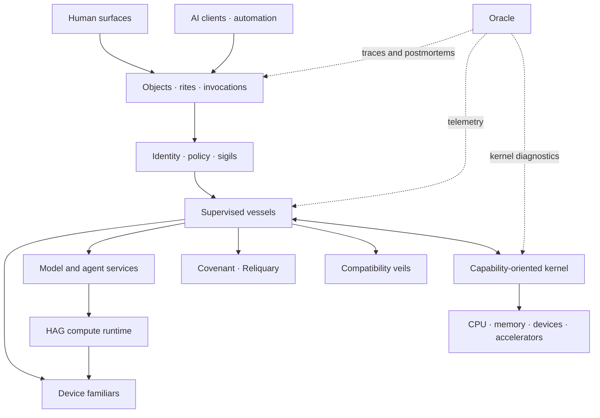

# Architecture overview

## Status

This document records the intended architecture. The milestone-0 boot path and
a bounded ring-0 bootstrap command environment are operational. The kernel owns
an x86-64 GDT, TSS, exception IDT, and fatal diagnostic path, and accepted
feature proofs now cover one fixed ring-3 boundary, bounded bootstrap memory
ownership, and BSP-only returning legacy-PC interrupts, monotonic time, and
private physical input. These remain narrow mechanisms rather than a general
process or platform model. The bootstrap shell is a temporary development aid,
not the proposed Canticle runtime. The control-plane ABI and development tooling
are early scaffolding; the higher-level components below remain designs unless a
linked current-status document says otherwise.

The earlier sustained-dispatch checkpoint is proposed
[ADR 0039](../adr/0039-prove-bounded-sustained-native-dispatch.md): a separate
bounded proof of 64 real PIT switches, one exact task-local fault, and 16 timer
ticks with one runnable survivor. All 23 validation targets passed, including
TCG/KVM dispatcher proofs and retained desktop regressions. An isolated
VirtualBox attempt was blocked by host KVM ownership of AMD-V and cleaned up.
The [execution-readiness audit](execution-readiness.md) distinguishes the
implemented experimental rite prefixes from the unimplemented native Reliquary
format and open canonical invocation encoding. A versioned native launch
contract supports the selected Ny/Antimatter userspace milestone; native
execution framing remains open. ADRs 0051/0052 below subsequently qualify
bounded userspace ELF loading and a Linux entry/device comparison. macOS
uses an independent Mach-O/Darwin veil. This proof does not complete the
remaining kernel execution prerequisites.

Proposed [ADR 0041](../adr/0041-plan-bounded-user-mappings-and-physical-access.md)
adds the next memory prerequisite: inert bounded user-mapping plans and checked
physical/high-half virtual window geometry. The planner checks exact permissions,
exclusions, and separate data/table budgets before returning immutable metadata.
It does not allocate frames, change the live mapper, or activate low user
addresses. All 19 new tests, focused freestanding checks, and 23 regression
targets passed. Normal, dispatcher, and workspace images remain byte-identical
to the preceding checkpoint.

Proposed [ADR 0042](../adr/0042-prove-inactive-owned-user-mapping-construction.md)
now constructs inactive user trees from those plans with actual table and data
leases. A temporary, fully checked supervisor RW+NX high alias supplies physical
access under the still-selected bootstrap root. Construction and cleanup failures
retain an inspectable owner; teardown clears the complete table arena before
withdrawing data bindings. Focused tests and all 24 regression targets passed,
including two-size memory proofs under TCG and KVM. This establishes owned inactive
construction; its user-only roots remain ineligible for activation.

Proposed [ADR 0043](../adr/0043-prove-resident-mapping-activation.md) adds an
explicit supervisor residency profile and a separate activation owner. Two
mixed roots preserve RX kernel text, read-only NX constants, writable NX data
and stacks, plus the retained high physical alias. A feature-local CPL0 proof
selects A, B, A, then bootstrap, checks independent user data and exact hardware
faults, and reclaims every lease. A permanent layout, general fault recovery,
and global W^X remain open. This phase is CPL0-only. See the
[activation log](../../notebook/Development/2026-09-26%20Resident%20Mapping%20Activation%20Log.md)
for validation evidence: all 24 regression targets passed, with the two-size
memory proof under TCG and KVM and matching normal/dispatcher/workspace images
at that checkpoint.

Proposed [ADR 0044](../adr/0044-prove-owned-low-address-user-execution.md) adds
two actual GPR-only user tasks over separate owned low-address roots, with real
task/circle identities, initialized-code admission, and guarded stack bounds.
Four exact private reports resume from noninitial stack pointers. B's exact
supervisor-read fault terminates B; A then continues and exits. Bootstrap, TS,
TSS selection, continuations, and all 28 owned frames/eight leases are restored.
The shared exception snapshot now reads the complete hardware RSP/SS tail for
CPL0, CPL3, and IST frames. All 24 validation targets passed, including the
96-MiB/320-MiB memory proofs and dispatcher/workspace proofs under TCG and KVM.
All 240 frozen source/configuration files remained unchanged. The
[user execution log](../../notebook/Development/2026-09-27%20Owned%20User%20Execution%20Log.md)
records final evidence and the changed runtime-image hashes from the shared
snapshot correction. The private handshake is not a syscall ABI, and this proof
adds no general loader, asynchronous dispatch for these roots, or production
user-copy at that checkpoint.

Proposed [ADR 0046](../adr/0046-prove-retained-prepared-launch-ownership.md)
subsequently retained preparation without a task, explicit ready-task commit,
and cancellation through mapping cleanup retries. All 24 regression targets
passed for that increment. The preceding proposed
[ADR 0047](../adr/0047-prove-sustained-dispatch-over-retained-launches.md)
composes two such owners with sustained dispatch, 36 retained frames and ten
bound leases, including two 16 KiB supervisor stacks accessed through a high
alias. It proves partial unstarted scheduler admission rollback and two stack
clear/retry cases, then 64 real preemptions, one exact UD2 fault, and 16 survivor
ticks. Both owners remain retained until both tasks are terminal. Focused
checks, two-size TCG/KVM runs, and all 26 regression targets qualified across
documented phases. The final 258-file freeze remained unchanged after a narrow
display-capture harness correction; normal/workspace images match recovery.
The [Owned Sustained Dispatch Log](../../notebook/Development/2026-10-03%20Owned%20Sustained%20Dispatch%20Log.md)
records final evidence, the interrupted attempt, and its diagnostic limit.
Clear/release retry preserves ownership; failed mapping revalidation stays
retained fail-closed without a recovery guarantee.

The preceding proposed
[ADR 0048](../adr/0048-prove-bounded-application-cpu-copy-and-fault-profile.md)
adds eager x87/SSE2 context ownership, copies of at most 4096 bytes checked
against the retained current-task owner, and selected #DE/#UD/#GP/#PF
containment with last-current cleanup. All 28 validation targets passed,
including two-size TCG Intel-baseline and actual AMD-host KVM proofs, on 265
unchanged frozen source files. The
[Application Profile Log](../../notebook/Development/2026-10-03%20Application%20Profile%20Log.md)
records final evidence and limits.
This internal profile excludes TLS and AVX/XSAVE and does not qualify all
untrusted application faults, a stable ABI, or a general loader.

The preceding proposed
[ADR 0049](../adr/0049-qualify-a-bounded-freestanding-ny-object.md)
qualifies one actual Ny scalar object and inspected startup shim on that
foundation. Copied initialized data, zero-filled globals, generated integer/f64
work, timer returns and failure/peer contrast are part of the bounded contract.
All 30 targets passed on 272 unchanged frozen files, including two-size TCG
and actual AMD-host KVM proofs. The
[Ny Object Log](../../notebook/Development/2026-10-03%20Ny%20Object%20Log.md)
records final evidence and limits.
The hosted runtime, a general Ny target and native Antimatter remain open.

Proposed [ADR 0050](../adr/0050-prove-a-bounded-native-application-contract.md)
implements a bounded Rust editor contract and independent surface/input service
over exact task-bound copied channels. The seven-state Antimatter reference
trace covers selection replacement, appearance preservation and undo; the
service scales the retained final CPU frame for presentation after bootstrap
restoration. All 33 matrix jobs passed on 291 unchanged frozen files, including
two-size TCG/KVM and capture proofs, recorded in the
[Native Application Log](../../notebook/Development/2026-10-03%20Native%20Application%20Log.md).
That checkpoint used ELF only as a host build container and did not port
Electron or the complete editor.

The completed checkpoint under proposed
[ADR 0051](../adr/0051-prove-userspace-elf-loading-against-native.md) introduces
a bounded runtime ELF path in an independent ring-3 loader. It parses a compact
sectionless ELF64 file and submits an inert plan through a checked copy. The
kernel admits the exact trusted manifest, reclaims the loader, and runs the same
client/service through native flat spans and ELF-derived spans. Both routes use
the native `int 0xf4` personality; the comparison covers data initialization,
zero-fill, service behavior, surface hashes, pixels and cleanup. All 35 matrix
jobs passed on 2026-10-04 with 302 frozen source files unchanged, including
two-size TCG/KVM proofs and captures. The
[ELF Application Log](../../notebook/Development/2026-10-03%20ELF%20Application%20Log.md)
records the bounded qualification; ADR 0051 remains Proposed.
Proposed [ADR 0052](../adr/0052-prove-linux-startup-and-record-device-syscalls.md)
qualifies that separate Linux startup/SYSCALL experiment. All 37 matrix jobs
and two restoration jobs passed on 313 unchanged frozen source files, including
two-size TCG/KVM boots and captures. One Linux producer uses fixed nonblocking
surface/input record devices; the independent peer remains a native INT f4 service. The comparison retains
seven editor states, six input commands, copied ownership and exit/fault cleanup.
This is a feature-private proof-controller bridge, not a production veil or
Linux-pipe/Electron compatibility. The
[Linux Application Log](../../notebook/Development/2026-10-04%20Linux%20Application%20Log.md)
records this historical checkpoint.

The preceding proposed [ADR 0053](../adr/0053-prove-a-supervised-userspace-syscall-veil.md)
implements the policy relocation in a third independent ring-3 vessel. Raw
syscall arguments cross a copied 80-byte request; Linux numbers, descriptors,
errno and poll rules execute in the veil. The kernel binds the blocked caller
and current veil, checks retained caller-memory access, and commits one staged
native effect only after validating the reply continuation. The native service
stays queued. A veil fault revokes the request, discards the stage and contains
both the veil and dependent caller while the service continues. Qualification
passed 39 matrix jobs and two restorations, recorded in the [Userspace Veil Log](../../notebook/Development/2026-10-04%20Userspace%20Veil%20Log.md).
The fixed startup fixture remains in the proof controller. This is one bounded
caller relation; ADR 0054 below extends its membership. Application runtime
services remain separately gated.

The preceding proposed [ADR 0054](../adr/0054-prove-a-shared-multi-caller-userspace-veil.md) qualifies two independent Linux editor
producers and two native services sharing one supervised veil. Exact sealed
membership, per-caller routes and copied-memory isolation preserve the native
baseline. A caller fault leaves its peer progressing; a veil fault revokes both
dependents and discards its staged effect while both native services survive.
All 41 qualification checks and two image restorations passed, including TCG/Intel and
KVM/AMD at both guest sizes with capture comparison. All twelve preceding
embedded artifact blobs remain unchanged and no OOM occurred. The
[Shared Veil Log](../../notebook/Development/2026-10-04%20Shared%20Veil%20Log.md) records the frozen-source and compiled-code evidence.
This is a fixed two-member serial service, not full Antimatter/Electron or a
general process/runtime service.

Proposed [ADR 0055](../adr/0055-prove-native-startup-and-private-userspace-arenas.md) implements the next bounded
native startup contract: a copied versioned descriptor, task-bound handles and
separately retained 32 KiB RW/NX arenas. An explicit four-region profile leaves
legacy three-region admission and copy checks intact. The editor's working
state and buffers live in userspace arena allocations; kernel ownership remains
authoritative independently of descriptor bytes. All 43 qualification checks and two image restorations passed,
recorded in the [Native Runtime Log](../../notebook/Development/2026-10-04%20Native%20Runtime%20Log.md).
Proposed [ADR 0056](../adr/0056-prove-task-bound-native-document-open-and-save.md) implements the next bounded
userspace contract: an editor and RAM document/render service, with four copied
routes and exact open/read/save/close replies. A saved reply changes only the
submitted snapshot's baseline; newer edits remain independent. Unknown outcomes
remain dirty even after undo to previously saved bytes. Bounded native
qualification passed; the
[Native Document Log](../../notebook/Development/2026-10-04%20Native%20Document%20Log.md)
records the evidence.
Close/reopen preserves RAM bytes only while the same service survives. Proposed
[ADR 0057](../adr/0057-prove-elf-loading-of-the-native-document-contract.md) implements
the ELF comparison using the unchanged native client and native personality.
A document-specific compactor elides a verified-zero RW file tail and proves
the reconstructed virtual image equal, preserving the existing parser, plan
and loader bounds. Each route independently passed the document wire oracle,
uncertain-save fault cases and final-pixel checks. Bounded qualification is
complete; evidence is in the
[ELF Document Log](../../notebook/Development/2026-10-04%20ELF%20Document%20Log.md).
Proposed [ADR 0058](../adr/0058-prove-native-editor-replacement-with-a-retained-document-service.md)
adds native editor replacement with the same RAM service retained. An explicit
bootstrap-stack maintenance interval retires only the editor, checks unchanged
service ownership/private state, and constructs a fresh editor and route
generation. The service receives checked successor metadata and changes its
document authority in userspace. The kernel does not recover document policy.

The three cases distinguish unsaved editor state, a queued save discarded before
commit and a committed save with a lost reply. A strict 122-record oracle checks
both editor incarnations against independent document bytes and semantic
checkpoints, with shared-renderer pixel evidence. All 50 qualification checks
and two development-image restorations passed, including TCG/Intel and KVM/AMD
at 96 MiB and 320 MiB with matching captures. The
[Native Relaunch Log](../../notebook/Development/2026-10-04%20Native%20Relaunch%20Log.md)
records the completed evidence.
Proposed [ADR 0059](../adr/0059-prove-elf-editor-replacement-against-the-native-baseline.md)
implements that replacement comparison through the userspace ELF loader. Each
scenario runs adjacent native and ELF routes, including every replacement
construction attempt. One shared runtime retains the same lifecycle invariants;
ELF parsing stays in userspace and grants no document or execution authority.
The strict 222-record oracle checks each route independently against native
bytes and semantic checkpoints. All 52 qualification checks and two
development-image restorations passed, including TCG/Intel and KVM/AMD at 96 MiB
and 320 MiB with matching captures. The
[ELF Relaunch Log](../../notebook/Development/2026-10-04%20ELF%20Relaunch%20Log.md)
records the completed bounded comparison.
Scoped filesystem persistence with explicit durability semantics follows. This
does not retain bytes across service destruction or implement full Antimatter/
Electron.

[ADR 0021](../adr/0021-prove-bounded-private-shell-session-ingress.md)
separately accepts an allocation-free, unsafe-free `no_std` host proof of
bounded semantic ingress, private queueing, and lost-wake-safe session waiting
above the kernel boundary. It is not linked into the kernel or
`anomalous-abi`, and it adds no native input reply or scheduler wake path. Its
origin labels are host-stamped attribution only: a trusted router must choose
them after establishing route policy, and they authenticate and authorize
nothing by themselves. The embedding host must exclusively reserve each
session-slot lineage and explicitly close the session, deliver any terminal
notice, and obtain its exact acknowledgement before destroying the owner. The
proof supplies no deployed router or session host, authentication, focus,
secure attention, secret entry, history, parser, evaluator, Canticle runtime,
or stable ABI.

[ADR 0022](../adr/0022-prove-bounded-native-session-input-and-exact-wake.md)
separately accepts one removable x86-64 nonempty semantic-reply and exact-wake
mechanism proof. It is not a production or normal-image input path.
[ADR 0023](../adr/0023-prove-bounded-authenticated-source-session-routing.md)
accepts a host-only router proof that consumes an external authentication
assertion and enforces exact source/focus retirement; it does not authenticate
credentials, decide focus policy, or define a deployed session service.
[ADR 0024](../adr/0024-prove-bounded-user-space-display-presentation.md)
accepts one removable ring-3 presentation proof beneath a semantic desktop.
[ADR 0025](../adr/0025-prove-bounded-canonical-semantic-desktop-scene.md)
accepts the separate host-only canonical-scene proof above it.
[ADR 0026](../adr/0026-compose-a-fixed-supervised-semantic-renderer.md)
accepts one removable composition proof with a host-derived redacted capsule,
a supervised ring-3 renderer, per-generation full-frame staging, and
publication only after a successful replacement. It defines no live scene
service, compositor, window protocol, input/action path, or normal-image
desktop.
[ADR 0027](../adr/0027-prove-bounded-transactional-semantic-surface-publication.md)
accepts a separate host-only transactional surface service above ADR 0025. It
keeps exactly one committed semantic revision and at most one private successor,
returns the complete candidate under strict backpressure, binds renderer work to
move-only fresh owners, permits one pre-attestation renderer replacement, and
publishes the successor's human, accessibility, and machine semantics together
only after an exact trusted-host presentation receipt. That receipt is an
assertion at the host boundary, not evidence that a renderer produced correct
pixels or that scanout completed. ADR 0027 defines no native live transport,
task or surface grant, compositor, window or input protocol, native presentation
evidence bound to a live semantic transaction, stable ABI, or normal-image
desktop service.
[ADR 0028](../adr/0028-prove-bounded-native-semantic-surface-transport.md)
accepts the next removable native boundary: one versioned 528-byte semantic-
surface body copied through one kernel-owned slot between separate fixed ring-3
source and consumer tasks. Their grants are disjoint (`semantic_surface_submit`
and `semantic_surface_read`), the kernel structurally validates and
transactionally copies the body, and the consumer independently checks the
complete fixed profile. A source may retire before delivery because the slot
owns its copied body; every rejection and fallible copy leaves ownership
unchanged, and terminal teardown restores and clears the exact feature state.
The closed-world evidence is redacted and content-free. This proves neither
rendering, presentation, scanout, nor semantic publication.
[ADR 0029](../adr/0029-prove-bounded-native-semantic-render-and-present-composition.md)
accepts the separate bounded composition proof. The exact candidate retained
by a live ADR 0027 host transaction crosses ADR 0028's copied transport into a
separately linked ring-3 renderer, fills one kernel-owned private stage, and is
acknowledged only after complete delivery, 768 ordered rows, and exact
successful exit. Native teardown precedes one preflighted framebuffer copy;
kernel readback, an independent host pixel oracle, and strict transcript
verification precede the retained host owners' exact publication to revision
2 and sequence 2.

That conformance bridge proves only one successful attempt. Its initial
framebuffer is a declared mutation baseline rather than a claimed rendering of
revision 1, and host failure after framebuffer mutation but before semantic
publication remains an explicit crash gap. It provides no native retry,
scanout proof, compositor, stable ABI, window service, or normal-image desktop.

## Shape of the system

[ADR 0030](../adr/0030-prove-bounded-presentation-recovery-coordination.md)
proposes a separate host recovery prerequisite in `anomalous-desktop-recovery`: retain the
actual surface transaction, make semantic views unavailable before an external
frame copy, and keep them unavailable until copy confirmation, semantic
publication and final acknowledgement agree. One fresh presenter can redraw
the retained redacted successor after interruption. This tests recovery while
the coordinator survives; it does not deploy native acknowledgement or recover
the loss of the canonical service process.

Anomalous is planned as a capability-oriented hybrid microkernel. The kernel
keeps mechanisms that require supervisor privilege:

- address spaces, memory protection, and low-level allocation;
- threads, scheduling, interrupts, and time;
- sigil validation and delegation primitives;
- bounded IPC and shared-memory setup;
- the minimum hardware bootstrap; and
- telemetry required to diagnose kernel failure.

Most policy and complexity belongs in restartable user-space vessels:

- device familiars;
- filesystems and storage;
- networking;
- identity and policy;
- Covenant and Reliquary validation;
- the compositor and semantic shell;
- the oracle observability system; and
- Linux, Windows, and macOS compatibility veils.

The boundary is pragmatic rather than doctrinaire. A mechanism moves into the
kernel only when measurements and invariants show that privilege or latency
requires it.

The implemented x86-64 descriptor, exception, fixed-circle, bootstrap-memory,
and interrupt/input contracts are recorded in the
[kernel foundation architecture](kernel.md).

## Shared semantic control plane

The control plane models discoverable objects and typed rites. A client submits
an invocation containing principal identity, trace identity, requested rite,
arguments, behavior flags, and a required sigil. The system returns a typed
plan or result and emits attributable events.

The desired sequence for a mutating operation is:

1. discover the rite and its schema;
2. submit an invocation for preview;
3. evaluate policy and required sigils;
4. expose effects, costs, uncertainty, and reversibility;
5. commit with an idempotency identity;
6. stream progress and permit cancellation where meaningful;
7. return a typed result; and
8. record audit and compensation information.

The graphical shell, command environment, and model and agent services are
clients of this same model. None receives an implicit authorization bypass.

## Open device control

Familiars publish versioned device objects and rites through the same semantic
control plane. Local UI, automation, and authorized remote clients should see
one discoverable model for device state and operations, including units,
constraints, latency, locality, failure modes, and required sigils. Transport
adapters may cross machines, but identity, policy, schema negotiation, and audit
meaning cannot disappear at that boundary.

The protocols and schemas of the open-source core are intended to remain open
and implementable independently. Hardware-specific or enterprise integrations
can extend them without creating a privileged private control plane.

## Compute execution data plane

HAG is the compute runtime intended to replace Vulkan. Model and agent semantics
belong in services above it, as selected by
[ADR 0045](../adr/0045-select-native-antimatter-ny-and-hag-direction.md).
HAG is not the semantic AI API and does not replace kernel mechanisms.
Efficient accelerator access will be built from explicit primitives:
memory placement and pinning, bounded zero-copy sharing, asynchronous work
queues, scheduling and accounting, interruption, IOMMU-confined DMA, and
accelerator familiars. Model weights, kernels, provenance, and context can be
described by Reliquary artifacts and governed by sigils.

This separation keeps high-level agent and model semantics evolvable while the
kernel exposes small, measurable primitives. “Bare metal” means avoiding
unnecessary copies and translation layers; it never means bypassing isolation,
policy, attribution, or recovery.

## Native development stack

Antimatter is the official editor. Ny is the official language direction for
Anomalous and HAG; existing verified Rust remains authoritative until a
qualified replacement meets the relevant ownership, ABI, failure, and
validation gates. ADR 0045 accepts product direction only. It does not qualify
a freestanding Ny runtime, HAG integration, or native Antimatter execution.

The next major userspace milestone after the kernel execution prerequisites is
a native Antimatter frontend that launches in its own application boundary and
renders through an explicit surface/presentation contract. Subsequent slices
add text input, editing, and persistent local files. Antimatter's current
Electron/React and CodeMirror renderer depends on browser facilities and needs
an explicit native port. Its product behavior and service contracts can guide
that port without requiring Chromium compatibility as the first milestone.

Bounded CPU reference rendering can precede HAG acceleration. Text layout,
rasterization, surface ownership, input, and presentation still need their own
contracts and evidence; a compute runtime alone does not provide them. The
preceding kernel increment qualified the bounded CPU/copy/fault profile over
retained launch dispatch. ADR 0049 qualified one pinned Ny object and startup
contract. ADR 0050 qualifies the first bounded Rust surface/input prototype.
Proposed ADR 0051 now qualifies the selected bounded userspace ELF comparison.
The Linux Antimatter copy outside the VM remains the behavioral
reference; ADR 0052 separately qualifies bounded guest Linux startup and
record-device syscalls. ADR 0053 implements a bounded independent userspace
veil. ADR 0054 qualifies a fixed two-caller shared service; production service
discovery and asynchronous requests remain open. ADR 0055 implements bounded
native startup and private arenas, with bounded qualification complete. ADR 0056
qualifies the bounded RAM document service.
ADR 0057 qualifies its bounded ELF comparison. ADR 0058 adds native editor
replacement with the RAM service retained; bounded qualification is complete.
ADR 0059 qualifies the same bounded retained-service replacement through the
userspace ELF loader against that native baseline. Scoped filesystem persistence
with explicit durability semantics is the next gate. Windows and
macOS comparisons remain later work. Full native frontend and
workspace persistence remain open. Antimatter is the intended first real
multi-ABI application test. The
[Native Antimatter Direction Log](../../notebook/Development/2026-10-03%20Native%20Antimatter%20Direction%20Log.md)
records the current source audit and measurable milestone boundaries.

## Protection and identity

A circle is the unit of memory and authority isolation. Sigils should be narrow,
delegable with attenuation, revocable where practical, and visible in the
service graph. Identity answers who initiated work; a sigil answers what the
holder may do. These must never be conflated.

Proposed [ADR 0040](../adr/0040-separate-entity-identity-authentication-and-authority.md)
develops this separation into a passwordless entity model for humans, agents,
and services. Authenticators establish control of an entity; separately granted
sigils authorize operations. Future biometrics verify the user locally before
a protected authenticator uses its key. Administrative and recovery operations
use scoped authority rather than a universal administrator identity. The
[identity and authority design](identity-and-authority.md) records enrollment,
delegation, revocation, recovery, and privacy boundaries. End-to-end
authentication and biometric integration are not implemented.

## Native filesystem

Accepted [ADR 0062](../adr/0062-design-native-object-filesystem.md) selects a
userspace filesystem with stable object identity, immutable content versions,
explicit views and separately granted live authority. Names and paths are
namespace bindings, not file identity. Native components, path length and depth
have no fixed global ceiling; streamed names and scoped traversal retain finite
work and memory accounting.

The [filesystem architecture](filesystem.md) defines copy-on-write project
transactions, structural and checksum validation, snapshots, verified mirror
repair, and backup completion proven at the receiving store. These are separate
implementation gates. Restoring content never restores live capabilities, and
fresh authority after rollback requires a source outside the restored backup.

There is no implemented filesystem or runtime block adapter today. ADR 0060's
five-sector document model is portable policy, while guest documents remain in
RAM. Proposed [ADR 0063](../adr/0063-prove-native-durable-document-storage.md)
defines the next narrower proof: a dedicated data extent, explicit durability,
complete editor/service destruction and exact recovery in a cold VM process.
The kernel must transport opaque sectors without adopting filesystem policy.

## Native artifacts

Reliquary is the versioned, chunked native executable and package artifact
format. It keeps execution entry records and payloads beside governed semantic
metadata, provenance, signatures, requested sigils, resource intent, and debug
information. The first revision may embed conventional machine code while the
native execution model evolves. The kernel consumes only a small validated
launch description; rich parsing and policy live in dedicated vessels.

## Package and environment state

Covenant resolves desired state into an immutable content-addressed graph. A
transaction is previewed, fetched, verified, staged, and atomically activated.
System generations support rollback without treating mutable user data as part
of a package snapshot.

## Compatibility

Each foreign platform lives behind a veil with an explicit compatibility tier:

- source or SDK portability;
- binary ABI or syscall personality;
- API translation;
- isolated virtual machine with semantic UI integration; or
- remote execution.

Linux is the initial TRI-ABI research target. Windows and macOS proceed
independently, and macOS work has an explicit legal-feasibility gate. macOS uses
Darwin/XNU with Mach and BSD components, as described in
[Apple's XNU source](https://github.com/apple-oss-distributions/xnu); Linux is not
its kernel base. No veil is allowed to expand the kernel into a monolithic
collection of foreign policy. Native surface composition is a reusable graphics
foundation, while executable loading, syscall/runtime behavior, and each
foreign display protocol remain separate compatibility work.

## Human interface

The shell renders semantic objects and rites. Neumorphic depth is conveyed
through design tokens and components, while contrast, focus, labels, shape, and
the accessibility tree carry state independently of shadow or motion.

[Canticle](canticle.md) is the proposed typed command language for the eventual
unprivileged shell vessel and direct machine AST clients. The current
five-command bootstrap interpreter has no authority model and does not implement
that language.

ADR 0021's removable host model gives later shell work a bounded semantic-action
and exact wait/acknowledgement contract. ADR 0022 proves only the corresponding
fixed native mechanism. Focus policy, production authenticated-source routing,
parsing, evaluation, and real human or machine authentication remain open;
ADR 0023 accepts only the local host routing boundary. ADR 0025 accepts one
host-only exact eight-node scene whose human render/accessibility and machine
projections share a committed revision, labels or redaction, focus, state, and
action identity. ADR 0026 now composes that revision into one separately linked
ring-3 renderer, discards a faulted private half-frame through bounded
supervision, and publishes only the complete successful replacement. ADR 0027
adds the distinct host-only transaction boundary: one private pending revision,
strict owner-returning backpressure, one fresh renderer retry, and atomic paired
semantic publication after a trusted-host presentation assertion. The local
snapshot is neither a wire format nor native presentation evidence, and the
trusted assertion does not verify the renderer, pixels, or scanout. A copied and
versioned native transport now proves one separate source-to-consumer delivery
with disjoint task grants, a kernel-owned copied slot, independent consumer
validation, source retirement before delivery, exact cleanup, and redacted
closed-world evidence. ADR 0029 composes the exact live ordinal-61 successor
through that transport, an isolated renderer, complete staging and teardown,
one framebuffer commit, independent pixel verification, and finally the
retained host transaction's paired semantic publication. This remains a
feature-only successful conformance run, not a native service: cross-process
presentation authority, crash-gap closure, renderer retry, window lifecycle,
general focus/input/action policy, a production compositor, display manager,
and a normal-image desktop service remain open. ADR 0032 starts a separate
bounded native workspace increment rather than generalizing these fixtures.

Proposed [ADR 0031](../adr/0031-add-an-interactive-bootstrap-desktop-development-image.md)
adds a separate, removable interactive development image. It renders the exact
public scene through the isolated native renderer before external interrupts
are initialized, then retains that public frame while Enter opens the existing
bootstrap shell. A development-only `desktop` command returns to the cached
launcher. This temporary kernel-hosted interaction loop does not deploy the
canonical service, publish a host semantic transaction, or establish general
focus, window, or accessibility-service policy.

Proposed [ADR 0032](../adr/0032-start-a-native-window-workspace-and-compositor-service.md)
adds a separate opt-in `workspace_dev` path with one persistent ring-3 desktop
owner. `anomalous-desktop-workspace` owns four public demo window slots, two
workspaces, four local client endpoints, and revisioned layout, focus, window
lifecycle, and configuration. `anomalous-desktop-compositor` derives complete
RGB8 rows from the same immutable view used by local machine and accessibility
observations. The keyboard and pointer adapters submit explicit typed commands through a
local human endpoint; a separately authorized local machine endpoint has the
same command vocabulary and grant checks. These local owners authenticate no
external process or remote agent.

The separately linked vessel contains RX code and private RW+NX data and stack.
The kernel supplies copied physical input, bounded interrupt waiting, a private
full-frame stage, complete-frame readback acknowledgement, and termination.
Desktop policy and composition remain in user space. Initial state is
unpublished; presentation gates observations and actions until the exact
candidate frame is acknowledged and its canonical revision publishes. A fault,
watchdog termination, or orderly exit withdraws the service and returns to the
bootstrap shell after resource reclamation. This first failure policy discards
workspace state. It does not implement ADR 0030's surviving-coordinator recovery.

The public demos establish a development boundary, not application isolation,
private surfaces, a cross-process agent API, or production scheduling. Text
input, persistence, application admission, semantic IPC, service recovery, and
GPU composition require further boundaries and evidence. Native smoke has
verified 21 complete frames and contained fault, watchdog, malformed-state,
and orderly-exit fallback. The full 20-target validation matrix passed;
measured results are recorded in the
[workspace development log](../../notebook/Development/2026-09-26%20Native%20Workspace%20Development%20Log.md).

Proposed [ADR 0033](../adr/0033-build-the-first-native-themes-and-pointer-window-shell.md)
adds the first official Light/Dark themes, a task panel, and native pointer
window controls. A separate allocation-free theme catalog resolves independently
selected colors, metrics, bitmap text size, cursor, and static depth. Validation
rejects insufficient contrast or geometry that strands existing windows before
publication. Login and audio component roles are explicitly unsupported; no
external asset loader or executable theme extension is admitted.

The compositor owns the shared painted and hit-tested decoration rectangles.
The user-space pointer adapter turns copied relative deltas and button state
into at most four canonical commands in one transaction. Capture is tied to an
exact window incarnation and expected revision, and cancels on release, loss,
keyboard actions, or invalidated targets. The opt-in kernel backend demultiplexes
keyboard and AUX bytes, bounds packet/loss queues, owns IRQ12/cascade lifecycle,
and exports no window policy. On withdrawal, the shell can start a fresh vessel
with `desktop`; each entry has a fresh pointer source generation. This is a
resource-restoring development round trip, not preservation after owner loss.

Proposed [ADR 0034](../adr/0034-build-shared-native-frame-assets-and-canonical-control-states.md)
extends the compiled theme contract with decoration-state colors and bounded
frame style. Anomalous Dark follows the local Antimatter Clay direction;
Anomalous Light interprets its orange/teal roles on warm light surfaces. Original
control vectors have one compiled source shared by native integer sampling and
host SVG export. Generated frame sheets and their internal manifest are design
references, not exact native pixels, a stable external package, or a runtime
SVG/font loader.

The compositor blends bounded static shadows over the destination and shares
rounded window silhouettes with pointer picking. Maximized and tiled frames
stay square and omit floating shadows. Pointer buttons are canonical state;
hover/pressed appearance derives from the published snapshot, and physical
packets submit position, buttons, and action in the same bounded atomic batch.
Independent frame/color overrides must validate together before publication.
The [Clay Frame Assets Log](../../notebook/Development/2026-09-26%20Clay%20Frame%20Assets%20Log.md)
separates current native and host evidence from the earlier accepted proofs.
The frame increment passed all 20 validation targets, including complete native
keyboard/pointer frames and resource-restoring termination. This development
result does not promote the proposed frame contract to a stable external ABI.

Proposed [ADR 0035](../adr/0035-add-a-built-in-appearance-app-with-shared-choice-state.md)
adds the built-in Appearance app to this same owner. Its singleton lifecycle,
sixteen typed choices, selected keyboard option, and resolved settings share
the ordinary canonical view. Opening requires manage and arrange authority;
selecting requires arrange; activation also requires customize. A complete
candidate remains subject to theme/geometry validation and presentation before
publication. Existing component setters and global shortcuts remain available.

The compositor shares bounded option geometry with pointer routing. It offers
explicit choices, keyboard selection/application, disabled incompatible palette
combinations, and a maximize fallback when the controls cannot fit. High
Contrast's effective flatness remains distinct from the retained depth
preference, and motion remains static. This app contains only fixed public
content; it adds no process, authenticated external client, storage, private
text, or stable application protocol. Settings last only for the current owner.

Native policy keeps invalid geometry/theme, capacity exhaustion, and too-small
layouts recoverable without publishing any rejected action. A rejected pointer
batch may publish position/buttons alone after cancelling capture. Source,
authority, transaction, and presentation failures retain the existing
resource-restoring withdrawal path. All 20 validation targets passed, with
21 exact keyboard frames and 337 pointer/Appearance frames across two sessions.
The [Appearance App Log](../../notebook/Development/2026-09-26%20Appearance%20App%20Log.md)
records final evidence independently of earlier full passes. Future console
work requires move-only private text owners and disclosure-aware views; private
text must not be added to this public `Copy` snapshot.

Proposed [ADR 0036](../adr/0036-activate-desktop-controls-on-pointer-release.md)
adds release-to-activate control gestures and canonical armed feedback. Typed
control identities are owned by the workspace; the compositor shares them for
picking and painting. An arm grants no action authority and must be explicitly
continued into each prepared revision. A release acts only on the same valid,
topmost target; keyboard input, chords, source loss, or a competing revision
cancel it. Unmapped keyboard makes and rejected actions still present a visible
arm's cancellation. A fresh pointer source first observes all buttons up.
The existing four-command bound and atomic full-frame publication remain in
force. Immediate window focus, dragging, and resizing are unchanged. Evidence
belongs in the [Desktop Click Lifecycle Log](../../notebook/Development/2026-09-26%20Desktop%20Click%20Lifecycle%20Log.md).

The mouse responsiveness follow-up optimizes this same presentation path. The
compositor directly fills fully opaque spans and skips shape, text, control,
and shadow work outside the current row; antialiased edge arithmetic is
preserved. Private mailbox copies use aligned volatile 64-bit accesses only
within the admitted byte range. The kernel uses aligned 32-bit framebuffer
writes/readback for suitable 32-bit modes, retains the byte path for other
layouts, and clears/verifies the complete owned stage with aligned RAM words
and exact byte edges. Raster output, raw input validation, authority checks,
completed row counts, and stage ownership transitions remain required.

Proposed [ADR 0037](../adr/0037-batch-ready-desktop-pointer-motion.md) adds
`consume_ready` in the user-space pointer adapter. One canonical update can
incorporate at most 16 already-ready continuous same-button packets, each with
its raw generation and sequence validated. Each delta is clamped to the
viewport in order; drag and resize retain their original capture anchor.
Button transitions, loss, keys, and source changes stay separate. At most one
fetched boundary record is preserved untouched, and no polling occurs beyond
the 16-packet cap or after the boundary. Fresh sources and transitions remain
singleton updates. A local adapter copy prevents partial state changes on
error; the native owner withdraws rather than retrying already-read input.

Batching changes the displayed cadence of queued continuous motion without
adding an intentional wait or bypassing gesture semantics. Semantic publication
still follows one canonical transaction and a complete acknowledged 768-row
frame. There is no new ABI, privilege boundary, or stable format. Graphical Linux QEMU defaults to KVM with TCG fallback;
`ANOMALOUS_QEMU_ACCEL=auto|kvm|tcg` controls interactive launches while the
automated proof backend remains unchanged. All 20 validation targets and an
additional complete KVM workspace smoke passed. Both native smoke runs
verified 21 keyboard and 410 pointer/Appearance frames, containment, and full
resource restoration. Native timings and five exact sustained-input frame
comparisons are recorded in the
[Mouse Responsiveness Log](../../notebook/Development/2026-09-26%20Mouse%20Responsiveness%20Log.md).

Proposed [ADR 0038](../adr/0038-add-native-window-content-surfaces.md) adds the
first caller-rendered window content. The portable, unsafe-free
`anomalous-window-surface` crate validates bounded RGB8 layouts, borrows frames
immutably, and provides caller-owned raster drawing. The canonical window
stores only public descriptor/label metadata and a nonwrapping content sequence.
A distinct `present` grant and move-only `surface_owner` bind replacements to a
client generation and exact window incarnation; `prepare_surface` uses the
current revision, one-successor backpressure, and existing complete-frame
acknowledgement. Initial Graphics Lab window/content creation is atomic.

The compositor validates the complete retained binding set before the external
presentation gate and then borrows the same immutable frames throughout all
rows. Nearest-neighbor sampling stays inside the shared `client_viewport`,
preserving z-order, decorations, and the pointer. Graphics Lab draws its two
small buffers once at service startup within the existing trusted workspace
vessel, then switches between retained immutable frames. No independent
producer, shared-memory transport, native rite, or foreign display protocol is
added. The public label, geometry, and content sequence describe this demo;
a general semantic tree and private-content policy remain open. All 20
validation targets and an additional complete KVM workspace smoke passed,
including 23 exact graphics frames in each workspace run. Native timing and an
exact sustained-input capture also passed. Evidence is recorded in the
[Window Content Surfaces Log](../../notebook/Development/2026-09-26%20Window%20Content%20Surfaces%20Log.md).

## Observability

The diagnostic contract begins in Threshold; machine-readable structured events
currently begin at Rust kernel entry. Trace identity will cross invocations and
vessel IPC. The oracle eventually assembles service graphs, metrics, logs,
symbolized crashes, capability history, and replay inputs. Debuggability is part
of each platform contract, not an optional build mode.

ADR 0021 also defines a content-free observation shape for its host proof, but
that shape authorizes no emission, transport, or retention. Event cadence,
volume, and timestamps added outside the proof can still disclose activity.
